# ERD – LaptopShop

> Giai đoạn 2 – Thiết kế CSDL · Phiên bản 1.1 · 13/11/2026 · Tên tiếng Việt không dấu (DB10)
> Database: `CuaHangLaptop` (SQL Server, collation `Vietnamese_CI_AS`)
> Nguồn chuẩn: `database/01_create_database.sql`. Chi tiết cột xem `DATABASE_DESIGN.md` mục 5.

## 1. Sơ đồ ERD tổng thể

Ký hiệu quan hệ (crow's foot): `||--o{` = 1 – 0..N · `||--|{` = 1 – 1..N · `|o--o{` = 0..1 – 0..N.
Trong sơ đồ chỉ ghi khóa và các cột chính; bảng `SanPham` có thêm khoảng 25 cột thông số (xem mục 2).

```mermaid
erDiagram
    NguoiDung ||--o{ DonHang : "đặt"
    NguoiDung ||--o{ GioHang : "có trong giỏ"
    NguoiDung ||--o{ DanhGia : "viết"
    NguoiDung ||--o{ LichSuTrangThaiDon : "thao tác"

    DanhMuc ||--o{ SanPham : "phân loại"
    ThuongHieu ||--o{ SanPham : "sản xuất"
    BoXuLy ||--o{ SanPham : "dùng CPU"
    CardDoHoa ||--o{ SanPham : "dùng GPU"

    SanPham ||--o{ HinhAnhSanPham : "có ảnh"
    SanPham ||--o{ SanPhamKhuyenMai : "được gắn"
    KhuyenMai ||--o{ SanPhamKhuyenMai : "áp dụng cho"
    SanPham ||--o{ GioHang : "nằm trong"
    SanPham ||--o{ ChiTietDonHang : "được bán"
    SanPham ||--o{ DanhGia : "được đánh giá"

    DonHang ||--|{ ChiTietDonHang : "gồm"
    DonHang ||--|{ LichSuTrangThaiDon : "lịch sử"
    KhuyenMai |o--o{ ChiTietDonHang : "đã áp dụng"

    NguoiDung {
        int MaNguoiDung PK
        varchar Email UK
        varchar MatKhauBam
        nvarchar HoTen
        varchar SoDienThoai
        varchar VaiTro "KHACH_HANG | QUAN_TRI"
        bit BiKhoa
    }
    DanhMuc {
        int MaDanhMuc PK
        nvarchar TenDanhMuc UK
        varchar DuongDanUrl UK
        bit DangHoatDong
    }
    ThuongHieu {
        int MaThuongHieu PK
        nvarchar TenThuongHieu UK
        varchar DuongDanUrl UK
        bit DangHoatDong
    }
    BoXuLy {
        int MaBoXuLy PK
        varchar HangSanXuat
        varchar DongChip
        varchar TenModel UK
        tinyint SoNhan
        tinyint SoLuongLuong
    }
    CardDoHoa {
        int MaCardDoHoa PK
        varchar HangSanXuat
        varchar TenModel UK
        varchar LoaiCard "TICH_HOP | ROI"
        tinyint BoNhoVramGB
    }
    SanPham {
        int MaSanPham PK
        varchar MaSku UK
        nvarchar TenSanPham UK
        varchar DuongDanUrl UK
        int MaDanhMuc FK
        int MaThuongHieu FK
        int MaBoXuLy FK
        int MaCardDoHoa FK
        decimal GiaBan
        int SoLuongTon
        smallint DungLuongRamGB
        smallint DungLuongOCungGB
        decimal KichThuocManHinhInch
        varchar TrangThai "DANG_BAN | NGUNG_BAN"
    }
    HinhAnhSanPham {
        int MaHinhAnh PK
        int MaSanPham FK
        nvarchar DuongDanAnh UK
        bit LaAnhDaiDien
        int ThuTu
    }
    KhuyenMai {
        int MaKhuyenMai PK
        nvarchar TenKhuyenMai UK
        varchar LoaiGiam "PHAN_TRAM | SO_TIEN"
        decimal GiaTriGiam
        datetime2 NgayBatDau
        datetime2 NgayKetThuc
        bit DangHoatDong
    }
    SanPhamKhuyenMai {
        int MaSanPham PK, FK
        int MaKhuyenMai PK, FK
    }
    GioHang {
        int MaGioHang PK
        int MaNguoiDung FK "UK(MaNguoiDung, MaSanPham)"
        int MaSanPham FK
        tinyint SoLuong "1-5"
    }
    DonHang {
        int MaDonHang PK
        varchar MaDonHienThi UK "LS000001"
        int MaNguoiDung FK
        varchar PhuongThucThanhToan "THANH_TOAN_KHI_NHAN | CHUYEN_KHOAN"
        varchar TrangThaiThanhToan "CHUA_THANH_TOAN | DA_THANH_TOAN | DA_HOAN_TIEN"
        varchar TrangThai "CHO_XAC_NHAN..DA_HUY"
        decimal TongTien
        datetime2 NgayTao
        datetime2 NgayGiaoThanhCong
    }
    ChiTietDonHang {
        int MaDonHang PK, FK
        int MaSanPham PK, FK
        nvarchar TenSanPham "snapshot"
        decimal DonGiaGoc "snapshot"
        decimal DonGiaBan "snapshot"
        int MaKhuyenMai FK
        tinyint SoLuong "1-5"
    }
    LichSuTrangThaiDon {
        int MaLichSu PK
        int MaDonHang FK
        varchar TuTrangThai
        varchar SangTrangThai
        int NguoiThucHien FK
        datetime2 ThoiDiem
    }
    DanhGia {
        int MaDanhGia PK
        int MaNguoiDung FK "UK(MaNguoiDung, MaSanPham)"
        int MaSanPham FK
        tinyint SoSao "1-5"
        nvarchar NoiDung
        bit BiAn
    }
    QuangCao {
        int MaQuangCao PK
        nvarchar TieuDe
        nvarchar DuongDanAnh
        nvarchar DuongDanLienKet
        bit DangHoatDong
    }
```

`QuangCao` là bảng độc lập (không có quan hệ khóa ngoại).

## 2. Các cột thông số kỹ thuật của `SanPham`

| Nhóm | Cột |
|---|---|
| CPU / GPU | `MaBoXuLy` → `BoXuLy`, `MaCardDoHoa` → `CardDoHoa` |
| RAM | `DungLuongRamGB`, `LoaiRam`, `BusRamMHz`, `SoKheRam`, `RamToiDaGB` |
| Lưu trữ | `DungLuongOCungGB`, `LoaiOCung` |
| Màn hình | `KichThuocManHinhInch`, `DoPhanGiaiNgang`, `DoPhanGiaiDoc`, `TamNen`, `TanSoQuetHz`, `CamUng` |
| Pin, vật lý | `DungLuongPinWh`, `TrongLuongKg`, `KichThuoc`, `ChatLieu`, `MauSac` |
| Kết nối, phần mềm | `CongKetNoi`, `KetNoiKhongDay`, `Webcam`, `DenBanPhim`, `HeDieuHanh`, `NamRaMat` |
| Thương mại | `GiaBan`, `SoLuongTon`, `BaoHanhThang`, `TrangThai` |
| Nội dung | `DongMay`, `MoTaNgan`, `MoTa` |

## 3. Bảng quan hệ

| # | Quan hệ | Loại | Khóa ngoại | Khi xóa bản ghi cha |
|---|---|---|---|---|
| R01 | NguoiDung – DonHang | 1 – N | `DonHang.MaNguoiDung` | Chặn (NO ACTION) – tài khoản chỉ khóa, không xóa |
| R02 | NguoiDung – GioHang | 1 – N | `GioHang.MaNguoiDung` | Xóa theo (CASCADE) |
| R03 | NguoiDung – DanhGia | 1 – N | `DanhGia.MaNguoiDung` | Chặn |
| R04 | NguoiDung – LichSuTrangThaiDon | 1 – N | `LichSuTrangThaiDon.NguoiThucHien` | Chặn |
| R05 | DanhMuc – SanPham | 1 – N | `SanPham.MaDanhMuc` | Chặn (BR11) |
| R06 | ThuongHieu – SanPham | 1 – N | `SanPham.MaThuongHieu` | Chặn (BR11) |
| R07 | BoXuLy – SanPham | 1 – N | `SanPham.MaBoXuLy` | Chặn |
| R08 | CardDoHoa – SanPham | 1 – N | `SanPham.MaCardDoHoa` | Chặn |
| R09 | SanPham – HinhAnhSanPham | 1 – N | `HinhAnhSanPham.MaSanPham` | Xóa theo |
| R10 | SanPham – KhuyenMai | **N – N** qua `SanPhamKhuyenMai` | `SanPhamKhuyenMai.MaSanPham`, `.MaKhuyenMai` | Xóa liên kết theo |
| R11 | SanPham – GioHang | 1 – N | `GioHang.MaSanPham` | Xóa theo |
| R12 | SanPham – ChiTietDonHang | 1 – N | `ChiTietDonHang.MaSanPham` | **Chặn** – SP đã bán không xóa được (BR09) |
| R13 | SanPham – DanhGia | 1 – N | `DanhGia.MaSanPham` | Chặn |
| R14 | DonHang – ChiTietDonHang | 1 – 1..N | `ChiTietDonHang.MaDonHang` | Chặn – đơn hàng không bị xóa |
| R15 | DonHang – LichSuTrangThaiDon | 1 – 1..N | `LichSuTrangThaiDon.MaDonHang` | Chặn |
| R16 | KhuyenMai – ChiTietDonHang | 0..1 – N | `ChiTietDonHang.MaKhuyenMai` (NULL được) | **Chặn** – KM đã áp dụng không xóa được, chỉ ngừng |

Quan hệ N – N thứ hai về mặt nghiệp vụ là **DonHang – SanPham** (một đơn có nhiều SP, một SP nằm trong nhiều đơn), được tách bằng bảng `ChiTietDonHang` có thêm thuộc tính riêng (số lượng, giá snapshot).
Tương tự, **NguoiDung – SanPham** qua `GioHang` (giỏ hàng) và qua `DanhGia` (đánh giá).
