# PROJECT_REQUIREMENTS – LaptopShop

> Giai đoạn 1 – Phân tích yêu cầu
> Phiên bản: 1.1 – **ĐÃ XÁC NHẬN** (13/11/2026)
> Ngày: 13/11/2026
> Ghi chú nhãn:
> - **[Đã xác nhận Dxx]**: quyết định đã được chủ dự án xác nhận (xem mục 12).
> - **[Đề xuất]**: do người phân tích đưa ra; được chấp nhận khi chủ dự án xác nhận v1.1 (xem mục 14).
> - **[Cần xác nhận Qxx]**: thông tin còn thiếu (xem mục 9).

## Lịch sử thay đổi tài liệu

| Phiên bản | Ngày | Nội dung |
|---|---|---|
| 0.1 | 12/11/2026 | Bản nháp đầu tiên |
| 0.2 | 13/11/2026 | Cập nhật 13 quyết định (D01–D13); bổ sung mục 12 (quyết định), mục 13 (kiểm tra nhất quán); bổ sung Q22–Q24 phát sinh từ kiểm tra nhất quán; thư mục dự án chuyển sang `F:\STUWeb\LaptopStore` |
| 1.0 | 13/11/2026 | Cập nhật D14–D26 (Q7, Q12, Q13, Q15–Q24); vai trò đổi tên `USER` → `CUSTOMER`; bỏ "giá niêm yết"; cập nhật luồng thanh toán chuyển khoản, sơ đồ 8.5; bổ sung mục 14 (đề xuất còn lại được chấp nhận cùng bản được xác nhận) |
| 1.1 | 13/11/2026 | Hoàn thiện Giai đoạn 1: mục 4 viết lại thành danh mục chức năng chi tiết (U01–U13, A01–A10, S01–S06); mục 7 gồm danh sách 25 UC, 3 sơ đồ Use Case, đặc tả UC chính; mục 8 bổ sung Activity 8.6–8.13; thêm mục 15 (ma trận truy vết), mục 16 (kiểm tra hoàn thành) |

---

## 1. Tổng quan

| Mục | Nội dung |
|---|---|
| Tên dự án | LaptopShop – Website thương mại điện tử bán laptop |
| Bối cảnh | Đồ án môn học Java Web – Trường ĐH Công nghệ Sài Gòn (STU) |
| Frontend | HTML5, CSS3, Bootstrap 5, JavaScript, jQuery, JSP |
| Backend | Java 17 (JDK 17.0.18), Jakarta Servlet, JSP, JSTL, JDBC, mô hình MVC |
| Thư viện | mssql-jdbc (driver), JSTL (bản Jakarta), Gson; băm mật khẩu PBKDF2 có sẵn trong JDK |
| Server | Apache Tomcat 10.1 (namespace `jakarta.*`) |
| Build / IDE | Maven 3.8.3, đóng gói WAR; IntelliJ IDEA Community |
| Database | Microsoft SQL Server (phiên bản có sẵn trên máy), Windows Authentication, PreparedStatement |
| Thư mục dự án | `F:\STUWeb\LaptopStore` |
| Không dùng | Spring / Spring Boot / Hibernate / Node.js / PHP / React |

### 1.1. Mục tiêu

1. Khách hàng tìm, lọc, so sánh thông số và mua laptop trực tuyến.
2. Quản trị viên quản lý danh mục, sản phẩm, tồn kho, đơn hàng, thành viên, khuyến mãi.
3. Thống kê lấy từ dữ liệu thật trong SQL Server.
4. Mã nguồn theo MVC, dễ đọc, có kiểm thử, chạy được để demo.

### 1.2. Phạm vi KHÔNG làm

- Cổng thanh toán trực tuyến (VNPay, MoMo…). Chỉ có COD và chuyển khoản do Admin xác nhận thủ công. **[Đã xác nhận D10]**
- Phí vận chuyển và tích hợp đơn vị vận chuyển (miễn phí vận chuyển). **[Đã xác nhận D11]**

Các mục dưới đây **[Đề xuất]**, chưa xác nhận:

- Mã giảm giá (coupon) nhập ở bước thanh toán. **[Đã xác nhận D15]**
- Vai trò Nhân viên (STAFF). **[Đã xác nhận D19]**
- File báo cáo đồ án (Word). Tài liệu dự án chỉ gồm các file `.md` trong thư mục `docs/`. **[Đã xác nhận D24]**
- Gửi email / SMS, quên mật khẩu qua email.
- Quản lý số serial từng máy, bảo hành sau bán.
- Ứng dụng di động, đa ngôn ngữ, đa tiền tệ.

---

## 2. Tác nhân (Actor)

| Actor | Mô tả |
|---|---|
| Khách vãng lai (Guest) | Chưa đăng nhập. Xem, tìm kiếm, lọc, xem chi tiết, xem đánh giá, đăng ký, đăng nhập. |
| Khách hàng (CUSTOMER) | Kế thừa Guest. Giỏ hàng, đặt hàng, lịch sử đơn, hồ sơ, đổi mật khẩu, đánh giá. |
| Quản trị viên (ADMIN) | Toàn quyền khu vực `/admin/*`. |
| Hệ thống SQL Server | Actor phụ: lưu trữ, ràng buộc, giao dịch. |

---

## 3. Đặc tính riêng của sản phẩm laptop

Laptop là sản phẩm có **nhiều thông số kỹ thuật dùng để lọc**. Thông số phải lưu dạng **có cấu trúc** (số, mã), không gộp vào một chuỗi mô tả, nếu không sẽ không lọc được bằng SQL.

| Nhóm | Thuộc tính | Kiểu dữ liệu gợi ý | Dùng để lọc |
|---|---|---|---|
| Định danh | Mã SKU, tên, slug, thương hiệu, danh mục, dòng máy (series), năm ra mắt, màu | NVARCHAR / FK | Thương hiệu, danh mục |
| CPU | Hãng (Intel/AMD/Apple), dòng (Core i5, Ryzen 7, M3…), model (i5-1335U), số nhân, số luồng, xung cơ bản/tối đa (GHz) | FK + số | Có (hãng, dòng) |
| RAM | Dung lượng (GB), loại (DDR4/DDR5/LPDDR5), bus (MHz), số khe, RAM tối đa, onboard hay rời | INT / NVARCHAR | Có (dung lượng) |
| Lưu trữ | Dung lượng (GB), loại (SSD NVMe / SATA / HDD), số khe M.2 trống | INT / NVARCHAR | Có (dung lượng SSD) |
| GPU | Loại (tích hợp / rời), model (RTX 4050…), VRAM (GB) | FK + INT | Có (loại, model) |
| Màn hình | Kích thước (inch), độ phân giải, tấm nền (IPS/OLED/TN), tần số quét (Hz), cảm ứng, độ phủ màu | DECIMAL(3,1) / INT / BIT | Có (kích thước) |
| Pin & vật lý | Dung lượng pin (Wh), trọng lượng (kg), kích thước (mm), chất liệu vỏ | DECIMAL | Tùy chọn |
| Kết nối | Cổng (USB-C, HDMI, Thunderbolt…), Wi‑Fi, Bluetooth, webcam, đèn bàn phím | NVARCHAR | Không |
| Phần mềm | Hệ điều hành (Windows 11 Home, macOS, No OS…) | FK / NVARCHAR | Tùy chọn |
| Thương mại | Giá bán gốc (1 giá duy nhất), tồn kho, bảo hành (tháng), trạng thái kinh doanh, ngày đăng | DECIMAL(18,0) / INT | Giá, còn hàng, sắp xếp |
| Hình ảnh | Nhiều ảnh / 1 sản phẩm, 1 ảnh đại diện, thứ tự hiển thị | Bảng con 1‑N | Không |

**Biến thể cấu hình – [Đã xác nhận D08]: Phương án A.**
Mỗi cấu hình laptop là **một sản phẩm riêng** (một dòng trong bảng sản phẩm, có SKU, giá, tồn kho riêng).
VD: "Dell Inspiron 15 3530 i5/8GB/512GB" và "Dell Inspiron 15 3530 i7/16GB/1TB" là 2 sản phẩm.
Hệ quả: giỏ hàng, đơn hàng, đánh giá, khuyến mãi đều tham chiếu trực tiếp `productId`; không có bảng biến thể.

**Giá sản phẩm – [Đã xác nhận D23]:** mỗi sản phẩm chỉ lưu **một giá bán gốc**. Giá khuyến mãi **không lưu trên sản phẩm** mà được tính tại Backend từ bảng khuyến mãi (BR15–BR17). Đơn hàng lưu snapshot giá tại thời điểm đặt (BR23).

---

## 4. Danh sách chức năng chi tiết

Quy ước: `Uxx` = chức năng phía khách, `Axx` = chức năng quản trị, `UCxx` = Use Case (mục 7), `BRxx` = quy tắc nghiệp vụ (mục 5).
Mọi dữ liệu hiển thị lấy từ SQL Server qua Backend, không dùng HTML tĩnh thay dữ liệu.

### 4.1. Chức năng phía khách (Guest / CUSTOMER)

| Mã | Chức năng | Chức năng con | Actor | UC | Quy tắc |
|---|---|---|---|---|---|
| U01 | Trang chủ | U01.1 Banner quảng cáo (từ DB) · U01.2 Danh sách danh mục · U01.3 SP mới nhất · U01.4 SP bán chạy trong tháng · U01.5 SP đánh giá cao · U01.6 SP đang khuyến mãi · U01.7 Liên kết tới chi tiết SP | Guest | UC01 | BR10, BR15–BR17, BR34b, BR37 |
| U02 | Tìm kiếm & lọc | U02.1 Theo tên · U02.2 Thương hiệu · U02.3 Danh mục · U02.4 Khoảng giá · U02.5 CPU · U02.6 RAM · U02.7 Dung lượng SSD · U02.8 Card đồ họa · U02.9 Kích thước màn hình · U02.10 Còn hàng · U02.11 Sắp xếp theo giá / tên / ngày đăng · U02.12 Phân trang OFFSET/FETCH · U02.13 Cập nhật kết quả bằng jQuery AJAX | Guest | UC02 | BR10, NF01, NF06 |
| U03 | Chi tiết sản phẩm | U03.1 Tên, thương hiệu, nhiều ảnh · U03.2 Giá bán gốc, giá sau KM · U03.3 Mô tả · U03.4 Thông số: CPU, RAM, ổ cứng, GPU, màn hình, pin, trọng lượng, HĐH, bảo hành · U03.5 Tồn kho · U03.6 Danh sách đánh giá + điểm trung bình | Guest | UC03 | BR10, BR16, BR33 |
| U04 | Đăng ký | Họ tên, email, SĐT, mật khẩu, nhập lại mật khẩu | Guest | UC04 | BR01, BR02 |
| U05 | Đăng nhập | Email + mật khẩu; chặn tài khoản bị khóa; điều hướng theo vai trò | Guest | UC05 | BR02–BR04 |
| U06 | Đăng xuất | Hủy session | CUSTOMER, ADMIN | UC06 | – |
| U07 | Cập nhật hồ sơ | Họ tên, SĐT, địa chỉ mặc định (email không đổi) | CUSTOMER | UC07 | BR01 |
| U08 | Đổi mật khẩu | Mật khẩu cũ, mật khẩu mới, nhập lại | CUSTOMER, ADMIN | UC08 | BR02 |
| U09 | Giỏ hàng | U09.1 Thêm SP · U09.2 Cập nhật số lượng · U09.3 Xóa SP · U09.4 Tính tổng tiền · U09.5 Kiểm tra tồn kho / SP ngừng KD | CUSTOMER | UC09 | BR18–BR20, D14, D21 |
| U10 | Đặt hàng | U10.1 Người nhận · U10.2 Địa chỉ giao hàng · U10.3 SĐT · U10.4 Ghi chú · U10.5 Chọn COD / chuyển khoản · U10.6 Xác nhận · U10.7 Lưu đơn + chi tiết đơn · U10.8 Trừ kho an toàn | CUSTOMER | UC10 | BR17, BR21–BR25, BR29 |
| U11 | Lịch sử & theo dõi đơn | Danh sách đơn của mình, chi tiết, trạng thái đơn, trạng thái thanh toán | CUSTOMER | UC11 | NF03 |
| U12 | Hủy đơn | Chỉ khi đơn `PENDING`; hoàn kho; đơn đã `PAID` → `REFUNDED` | CUSTOMER | UC12 | BR27, BR28, D22 |
| U13 | Đánh giá sản phẩm | Viết đánh giá 1–5 sao + nội dung; sửa đánh giá của mình; không xóa | CUSTOMER | UC13 | BR30–BR33, D18 |

### 4.2. Chức năng quản trị (ADMIN)

| Mã | Chức năng | Chức năng con | UC | Quy tắc |
|---|---|---|---|---|
| A01 | Dashboard | Tổng doanh thu · tổng đơn · tổng SP · tổng thành viên · đơn mới (PENDING) · SP bán chạy · SP tồn kho thấp | UC14 | BR34, BR34b, BR35 |
| A02 | Quản lý danh mục | Thêm · sửa · xóa có kiểm tra ràng buộc · ẩn · danh sách · tìm kiếm | UC15 | BR11 |
| A03 | Quản lý thương hiệu | Thêm · sửa · xóa có kiểm tra ràng buộc · ẩn · danh sách · tìm kiếm | UC16 | BR11 |
| A04 | Quản lý sản phẩm | Thêm · sửa · xóa (chưa có đơn) / ngừng kinh doanh · quản lý ảnh (upload, ảnh đại diện, thứ tự) · thông số kỹ thuật · giá · tồn kho · tìm kiếm · phân trang | UC17 | BR07–BR12, D20, NF05 |
| A05 | Quản lý đơn hàng | Danh sách (lọc theo trạng thái, ngày, phương thức) · xem chi tiết | UC18 | – |
| A05b | Cập nhật trạng thái đơn | Xác nhận · chuyển đang giao · đã giao · hủy | UC19 | BR26–BR28, D22 |
| A05c | Theo dõi thanh toán | Xác nhận đã nhận chuyển khoản (`PAID`) · xem trạng thái thanh toán | UC20 | BR29, D22 |
| A06 | Quản lý thành viên | Danh sách · tìm kiếm · xem thông tin + lịch sử đơn · khóa/mở · đổi vai trò | UC21 | BR03, BR05 |
| A07 | Quản lý khuyến mãi | Tạo · sửa · xóa (chưa áp dụng) / ngừng hoạt động · thời gian · mức giảm · gắn/bỏ gắn SP · kiểm tra điều kiện áp dụng | UC22 | BR13–BR17 |
| A08 | Thống kê | Bán chạy trong tháng · bán chạy trong năm · đánh giá cao · chưa bán được · tồn kho thấp · doanh thu theo ngày/tháng/năm · đơn theo trạng thái | UC25 | BR34–BR37 |
| A09 | Quản lý đánh giá | Danh sách · ẩn / hiện lại | UC23 | D18 |
| A10 | Quản lý banner | Thêm · sửa · ẩn · thứ tự hiển thị | UC24 | D20 |

### 4.3. Chức năng hệ thống (không có giao diện riêng)

| Mã | Chức năng | Quy tắc |
|---|---|---|
| S01 | Lọc mã hóa UTF‑8 cho mọi request | NF08 |
| S02 | Kiểm tra đăng nhập (`AuthFilter`) và quyền Admin (`AdminFilter`); kiểm tra tài khoản bị khóa ở mỗi request | BR03, BR04, NF03 |
| S03 | Tính giá hiện hành của sản phẩm (áp KM lớn nhất đang hiệu lực) – dùng chung cho trang chủ, danh sách, chi tiết, giỏ hàng, đặt hàng | BR15–BR17 |
| S04 | Phục vụ ảnh từ thư mục ngoài WebApp | NF05, D20 |
| S05 | Trang lỗi 403 / 404 / 500, ghi log lỗi phía server | NF11 |
| S06 | Thông báo thành công / thất bại (flash message) | NF09 |

---

## 5. Quy tắc nghiệp vụ (Business Rules)

> Mỗi quy tắc mang nhãn `[Đã xác nhận Dxx]` hoặc `[Đề xuất]` (đề xuất được liệt kê ở mục 14).

### 5.1. Tài khoản & phân quyền

- **BR01** Email là duy nhất (UNIQUE). SĐT định dạng VN 10 số, bắt đầu bằng 0.
- **BR02** Mật khẩu ≥ 8 ký tự, có chữ và số; lưu dạng **băm có salt** bằng **PBKDF2** có sẵn trong JDK (`PBKDF2WithHmacSHA256`, salt ngẫu nhiên riêng từng user) – không lưu plain text. **[Đã xác nhận D07]** (Thông số: số vòng lặp, độ dài salt/hash sẽ chốt ở GĐ3.)
- **BR03** Tài khoản bị khóa không đăng nhập được; nếu đang đăng nhập thì bị đăng xuất ở request kế tiếp.
- **BR04** Chỉ hai vai trò: `CUSTOMER`, `ADMIN` (không có STAFF). Mọi URL `/admin/*` chỉ ADMIN truy cập (Filter). URL giỏ hàng/đặt hàng/hồ sơ/đánh giá yêu cầu đăng nhập. **[Đã xác nhận D19]**
- **BR05** Admin không được tự khóa hoặc tự hạ quyền chính mình; hệ thống luôn còn ít nhất 1 ADMIN hoạt động.
- **BR06** Tài khoản admin đầu tiên tạo bằng script SQL seed (mật khẩu đã băm), không ghi cứng trong code.

### 5.2. Sản phẩm, danh mục, giá

- **BR07** Giá bán gốc > 0. Giá sau khuyến mãi (tính từ bảng KM) phải > 0 và < giá bán gốc. Tiền tệ VND, kiểu `DECIMAL(18,0)`. **[Đã xác nhận D23]**
- **BR08** Tồn kho ≥ 0 (CHECK).
- **BR09** Sản phẩm đã phát sinh đơn hàng → **không xóa cứng**, chỉ chuyển "ngừng kinh doanh". Sản phẩm chưa có đơn → được xóa.
- **BR10** Sản phẩm ngừng kinh doanh không hiển thị với khách, không thêm vào giỏ được.
- **BR11** Danh mục/thương hiệu còn sản phẩm → không cho xóa (báo lỗi), chỉ cho ẩn.
- **BR12** SKU và tên sản phẩm là duy nhất.

### 5.3. Khuyến mãi

- **BR13** Khuyến mãi có: tên, loại giảm (`PERCENT` / `AMOUNT`), giá trị, ngày bắt đầu, ngày kết thúc, trạng thái hoạt động.
- **BR14** `PERCENT`: 1–90 %. `AMOUNT`: > 0 và giá sau giảm > 0. Ngày kết thúc > ngày bắt đầu.
- **BR15** Khuyến mãi chỉ áp dụng khi: đang hoạt động **và** `NOW` nằm trong [bắt đầu, kết thúc].
- **BR16** Một sản phẩm có nhiều khuyến mãi hợp lệ cùng lúc → chỉ áp dụng **mức giảm lớn nhất**, không cộng dồn. **[Đã xác nhận D12]**
  - Cách so sánh "lớn nhất": quy đổi mọi khuyến mãi về **số tiền giảm (VND)** trên giá bán hiện tại rồi lấy số tiền lớn nhất (vì `PERCENT` và `AMOUNT` không so sánh trực tiếp được). Nếu bằng nhau → lấy khuyến mãi có ngày kết thúc sớm hơn. **[Đề xuất – làm rõ D12]**
- **BR17** Giá khuyến mãi được **tính tại Backend** khi hiển thị và khi đặt hàng; không tin giá gửi từ trình duyệt.

### 5.4. Giỏ hàng

- **BR18** Số lượng mỗi sản phẩm trong giỏ và trong đơn: 1 ≤ qty ≤ min(5, tồn kho hiện tại). Kiểm tra cả ở giỏ hàng và lúc đặt hàng; DB có CHECK `quantity BETWEEN 1 AND 5`. **[Đã xác nhận D21]**
- **BR19** Giỏ hàng **không lưu giá**; luôn hiển thị giá hiện tại (đã áp khuyến mãi). Nếu tồn kho giảm dưới số lượng trong giỏ hoặc SP ngừng kinh doanh → thông báo khi mở giỏ/checkout.
- **BR20** Giỏ hàng lưu trong **Database**, gắn với tài khoản (`userId`); không mất khi đăng xuất, dùng được trên nhiều thiết bị. Mỗi cặp (`userId`, `productId`) chỉ có 1 dòng (UNIQUE); thêm SP đã có thì cộng dồn số lượng. **[Đã xác nhận D09]**
  - Khách vãng lai **không** có giỏ hàng. Bấm "Thêm vào giỏ" khi chưa đăng nhập → chuyển sang trang đăng nhập, đăng nhập xong quay lại trang sản phẩm. **[Đã xác nhận D14]**

### 5.5. Đặt hàng & tồn kho

- **BR21** Đặt hàng chạy trong **một transaction JDBC** (`setAutoCommit(false)`): kiểm tra tồn kho → tạo `Orders` → tạo `OrderDetail` → trừ kho → xóa giỏ → `commit`. Lỗi bất kỳ → `rollback`.
- **BR22** Trừ kho an toàn chống bán vượt: `UPDATE Product SET stock = stock - ? WHERE id = ? AND stock >= ?`; nếu số dòng bị ảnh hưởng = 0 → rollback, báo hết hàng.
- **BR23** `OrderDetail` lưu **snapshot** tên SP, đơn giá, giá sau KM tại thời điểm đặt; đổi giá về sau không ảnh hưởng đơn cũ.
- **BR24** Thông tin người nhận (tên, SĐT, địa chỉ) lưu trong đơn, độc lập với hồ sơ.
- **BR25** **Miễn phí vận chuyển**. Tổng thanh toán = Σ (đơn giá sau KM × số lượng). Không có cột/phép tính phí ship. **[Đã xác nhận D11]**
- **BR26** Vòng đời trạng thái đơn hàng **[Đã xác nhận D16]**:

```
PENDING (Chờ xác nhận)
   ├─> CONFIRMED (Đã xác nhận) ──> SHIPPING (Đang giao) ──> DELIVERED (Đã giao)
   └─> CANCELLED (Đã hủy)
CONFIRMED ──> CANCELLED
```

- **BR27** Khách chỉ được hủy khi đơn ở `PENDING`. Admin hủy được ở `PENDING`, `CONFIRMED`. Không chuyển ngược trạng thái. `DELIVERED` và `CANCELLED` là trạng thái cuối. **[Đề xuất, đi kèm D16]**
- **BR28** Hủy đơn → **hoàn lại tồn kho** (trong transaction).
- **BR29** Phương thức thanh toán: `COD` và `BANK_TRANSFER`. **[Đã xác nhận D10]**
  - Trạng thái thanh toán: `UNPAID`, `PAID`, `REFUNDED` **[Đề xuất]**.
  - COD: chuyển `PAID` khi đơn `DELIVERED` **[Đề xuất]**.
  - BANK_TRANSFER: Admin xác nhận đã nhận tiền thủ công → `PAID`. Đơn chuyển khoản **phải `PAID` trước khi được chuyển sang `CONFIRMED`**. **[Đã xác nhận D22]**
  - Hủy đơn đã `PAID` (khách hủy ở `PENDING` hoặc Admin hủy) → `payment = REFUNDED`. Việc hoàn tiền thực tế làm ngoài hệ thống, hệ thống chỉ ghi nhận. Hủy đơn `UNPAID` → giữ `UNPAID`. **[Đã xác nhận D22]**
  - Không lưu thông tin thẻ/tài khoản ngân hàng của khách. Thông tin tài khoản nhận tiền của cửa hàng hiển thị ở trang checkout, lấy từ cấu hình (không ghi cứng trong code).

### 5.6. Đánh giá

- **BR30** Chỉ Customer có đơn chứa sản phẩm đó ở trạng thái `DELIVERED` mới được đánh giá. (Phụ thuộc danh sách trạng thái ở Q13.)
- **BR31** Mỗi khách đánh giá mỗi sản phẩm **1 lần** (UNIQUE `userId, productId`) **[Đề xuất]**. Khách **được sửa**, **không được xóa** đánh giá của mình. Admin **được ẩn / hiện lại** đánh giá (không xóa cứng). **[Đã xác nhận D18]**
- **BR32** Điểm 1–5 (CHECK). Nội dung 10–1000 ký tự. Nội dung được escape khi hiển thị (chống XSS).
- **BR33** Điểm trung bình = AVG các đánh giá **đang hiển thị** (không tính đánh giá bị Admin ẩn), làm tròn 1 chữ số thập phân.

### 5.7. Thống kê

- **BR34** **Doanh thu** chỉ tính đơn có trạng thái `DELIVERED`, không phụ thuộc trạng thái thanh toán; không tính đơn hủy. Mốc thời gian để gom doanh thu theo ngày/tháng: **[Đề xuất]** ngày đơn chuyển sang `DELIVERED`. **[Đã xác nhận D13]**
- **BR34b** Các thống kê "bán chạy tháng/năm", "chưa bán được", "sản phẩm bán chạy" trên Dashboard và trang chủ **chỉ tính đơn `DELIVERED`**, cùng nguyên tắc với doanh thu. **[Đã xác nhận D26]**
- **BR35** "Tồn kho thấp": tồn kho ≤ ngưỡng (mặc định 5, cấu hình được).
- **BR36** "Chưa bán được": sản phẩm đang kinh doanh, không xuất hiện trong đơn hợp lệ trong khoảng thời gian chọn.
- **BR37** "Sản phẩm mới" trên trang chủ: N sản phẩm có ngày đăng mới nhất. "Đánh giá cao": AVG ≥ 4 và có ≥ 1 đánh giá, sắp theo AVG giảm dần.

---

## 6. Yêu cầu phi chức năng

| Mã | Nhóm | Yêu cầu |
|---|---|---|
| NF01 | Bảo mật | 100% truy vấn dùng `PreparedStatement`; không nối chuỗi SQL. Cột sắp xếp dùng whitelist. |
| NF02 | Bảo mật | Mật khẩu băm PBKDF2 có salt. Kết nối DB dùng **Windows Authentication** (`integratedSecurity=true`) nên **không có mật khẩu DB** trong cấu hình; tên server, cổng, tên database đặt trong `db.properties` (có file mẫu `db.properties.example`). |
| NF03 | Bảo mật | `AuthFilter` (khách hàng) và `AdminFilter` (/admin/*). Kiểm tra quyền sở hữu: khách chỉ xem đơn của mình. |
| NF04 | Bảo mật | Chống XSS: hiển thị bằng JSTL `<c:out>` / `fn:escapeXml`. Chống CSRF: token cho form POST **[Đề xuất]**. Thao tác thay đổi dữ liệu chỉ qua POST. |
| NF05 | Bảo mật | Upload ảnh: chỉ jpg/png/webp, ≤ 2 MB, đổi tên file ngẫu nhiên. Ảnh lưu ở **thư mục nằm ngoài WebApp** (đường dẫn gốc đặt trong file cấu hình); SQL Server chỉ lưu **đường dẫn tương đối** của ảnh; một Servlet riêng đọc file và trả ảnh cho trình duyệt, có chặn `../` (path traversal). **[Đã xác nhận D20]** |
| NF06 | Hiệu năng | Phân trang tại DB (`OFFSET … FETCH NEXT …`), 12 SP/trang khách, 10 dòng/trang admin. INDEX cho cột lọc: brand, category, price, ram, storage, screen, createdAt. |
| NF07 | Tính đúng | Đặt hàng/hủy đơn dùng transaction; tồn kho không âm. |
| NF08 | Tiếng Việt | Cột chuỗi dùng `NVARCHAR`; `EncodingFilter` UTF‑8; JSP `pageEncoding="UTF-8"`. |
| NF09 | Giao diện | Bootstrap 5, responsive (≥ 360px), giao diện đồng nhất qua `header.jsp`/`footer.jsp`; thông báo thành công/thất bại (flash message). |
| NF10 | Bảo trì | MVC tách lớp; chú thích tiếng Việt ở nghiệp vụ quan trọng; không trùng lặp class/method. |
| NF11 | Lỗi | Trang lỗi 403/404/500 thân thiện; không lộ stack trace cho người dùng; ghi log phía server. |
| NF12 | Dữ liệu | Dữ liệu demo: ≥ 6 thương hiệu, ≥ 5 danh mục, ≥ 40 laptop, ≥ 10 khách, ≥ 30 đơn rải theo nhiều tháng để thống kê có ý nghĩa. |

---

## 7. Use Case

> Mermaid không có cú pháp Use Case UML; các sơ đồ dưới đây dùng `flowchart` để biểu diễn tương đương: hình người = actor (ghi chú bằng nhãn), hình elip = use case, nét đứt `include` / `extend`. Do không làm file báo cáo (D24), đây là bản chính thức.

### 7.1. Danh sách Use Case

| UC | Tên | Actor chính | Chức năng |
|---|---|---|---|
| UC01 | Xem trang chủ | Guest | U01 |
| UC02 | Tìm kiếm, lọc, sắp xếp sản phẩm | Guest | U02 |
| UC03 | Xem chi tiết sản phẩm | Guest | U03 |
| UC04 | Đăng ký | Guest | U04 |
| UC05 | Đăng nhập | Guest | U05 |
| UC06 | Đăng xuất | CUSTOMER, ADMIN | U06 |
| UC07 | Cập nhật hồ sơ | CUSTOMER | U07 |
| UC08 | Đổi mật khẩu | CUSTOMER, ADMIN | U08 |
| UC09 | Quản lý giỏ hàng | CUSTOMER | U09 |
| UC10 | Đặt hàng | CUSTOMER | U10 |
| UC11 | Xem lịch sử, chi tiết đơn hàng | CUSTOMER | U11 |
| UC12 | Hủy đơn hàng | CUSTOMER | U12 |
| UC13 | Đánh giá sản phẩm | CUSTOMER | U13 |
| UC14 | Xem Dashboard | ADMIN | A01 |
| UC15 | Quản lý danh mục | ADMIN | A02 |
| UC16 | Quản lý thương hiệu | ADMIN | A03 |
| UC17 | Quản lý sản phẩm | ADMIN | A04 |
| UC18 | Xem đơn hàng | ADMIN | A05 |
| UC19 | Cập nhật trạng thái đơn | ADMIN | A05b |
| UC20 | Xác nhận thanh toán | ADMIN | A05c |
| UC21 | Quản lý thành viên | ADMIN | A06 |
| UC22 | Quản lý khuyến mãi | ADMIN | A07 |
| UC23 | Quản lý đánh giá | ADMIN | A09 |
| UC24 | Quản lý banner | ADMIN | A10 |
| UC25 | Xem thống kê | ADMIN | A08 |

### 7.2. Sơ đồ Use Case tổng quát

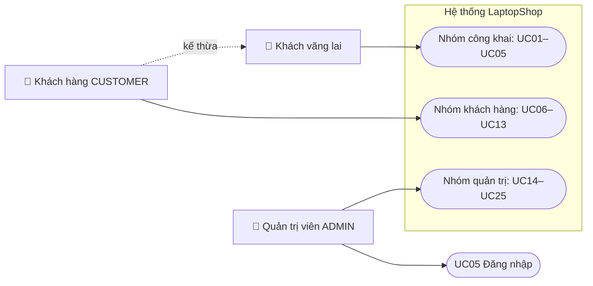

### 7.3. Sơ đồ Use Case – Khách vãng lai và Khách hàng

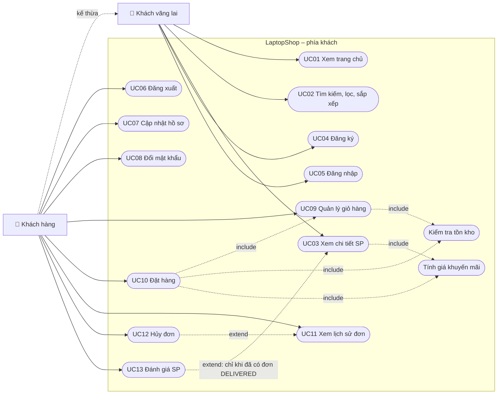

### 7.4. Sơ đồ Use Case – Quản trị viên

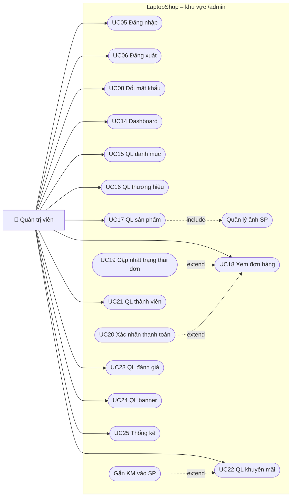

### 7.5. Đặc tả Use Case chính

> Các UC quản lý dạng CRUD đơn giản (UC15, UC16, UC23, UC24) dùng chung khuôn mẫu: danh sách có tìm kiếm + phân trang → thêm/sửa qua form có kiểm tra dữ liệu → xóa/ẩn có kiểm tra ràng buộc → thông báo kết quả. Không đặc tả lặp lại.

#### UC04 – Đăng ký

| Mục | Nội dung |
|---|---|
| Actor | Khách vãng lai |
| Tiền điều kiện | Chưa đăng nhập |
| Luồng chính | 1. Mở trang đăng ký. 2. Nhập họ tên, email, SĐT, mật khẩu, nhập lại mật khẩu. 3. Gửi form (POST). 4. Hệ thống kiểm tra dữ liệu và email chưa tồn tại. 5. Băm mật khẩu PBKDF2, tạo tài khoản vai trò `CUSTOMER`, trạng thái hoạt động. 6. Chuyển trang đăng nhập + thông báo thành công. |
| Ngoại lệ | 4a. Dữ liệu sai định dạng / mật khẩu không khớp → báo lỗi từng trường, giữ lại dữ liệu đã nhập (trừ mật khẩu). 4b. Email đã tồn tại → báo lỗi. |
| Hậu điều kiện | Có 1 tài khoản mới vai trò `CUSTOMER` |
| Quy tắc | BR01, BR02 |

#### UC05 – Đăng nhập

| Mục | Nội dung |
|---|---|
| Actor | Khách vãng lai (trở thành CUSTOMER hoặc ADMIN) |
| Tiền điều kiện | Chưa đăng nhập |
| Luồng chính | 1. Nhập email, mật khẩu. 2. Hệ thống tìm tài khoản theo email, so khớp hash. 3. Kiểm tra tài khoản không bị khóa. 4. Tạo session mới (đổi session ID). 5. ADMIN → `/admin/dashboard`; CUSTOMER → trang trước đó (VD: trang SP vừa bấm "Thêm vào giỏ") hoặc trang chủ. |
| Ngoại lệ | 2a. Sai email hoặc mật khẩu → thông báo chung "Sai email hoặc mật khẩu" (không tiết lộ email có tồn tại). 3a. Tài khoản bị khóa → từ chối, thông báo. |
| Hậu điều kiện | Session chứa thông tin user (không chứa mật khẩu) |
| Quy tắc | BR02, BR03, BR04 |

#### UC02 – Tìm kiếm, lọc, sắp xếp sản phẩm

| Mục | Nội dung |
|---|---|
| Actor | Khách vãng lai, Khách hàng |
| Tiền điều kiện | – |
| Luồng chính | 1. Mở trang danh sách SP (có thể kèm từ khóa từ ô tìm kiếm). 2. Chọn tiêu chí: tên, thương hiệu, danh mục, khoảng giá, CPU, RAM, SSD, GPU, kích thước màn hình, còn hàng; chọn sắp xếp; chọn trang. 3. jQuery gửi tiêu chí lên Servlet (GET). 4. Servlet kiểm tra, chuẩn hóa tham số. 5. DAO dựng câu truy vấn động bằng PreparedStatement, đếm tổng và lấy đúng 1 trang bằng `OFFSET/FETCH`. 6. Trả kết quả; jQuery cập nhật danh sách, phân trang, URL. |
| Ngoại lệ | 4a. Tham số không hợp lệ (giá âm, trang < 1, cột sắp xếp lạ) → bỏ qua / dùng giá trị mặc định. 5a. Không có kết quả → hiển thị "Không tìm thấy sản phẩm phù hợp". |
| Hậu điều kiện | Không thay đổi dữ liệu |
| Quy tắc | BR10, NF01, NF06 |

#### UC09 – Quản lý giỏ hàng

| Mục | Nội dung |
|---|---|
| Actor | Khách hàng |
| Tiền điều kiện | Đã đăng nhập (chưa đăng nhập → chuyển trang đăng nhập rồi quay lại – D14) |
| Luồng chính | Thêm: 1. Bấm "Thêm vào giỏ". 2. Hệ thống kiểm tra SP đang kinh doanh, còn hàng. 3. Nếu SP đã có trong giỏ → cộng số lượng; chưa có → thêm dòng mới. 4. Thông báo thành công, cập nhật số lượng trên biểu tượng giỏ. Sửa: nhập số lượng mới → kiểm tra → lưu. Xóa: bấm xóa → xóa dòng. Xem: hiển thị giá hiện hành (đã áp KM), thành tiền, tổng tiền. |
| Ngoại lệ | 2a. SP ngừng KD / hết hàng → báo lỗi. 3a. Số lượng vượt min(5, tồn kho) → giữ mức tối đa cho phép và thông báo. Xem: SP trong giỏ đã ngừng KD hoặc tồn kho không đủ → đánh dấu, không cho checkout tới khi sửa. |
| Hậu điều kiện | Giỏ hàng trong DB được cập nhật |
| Quy tắc | BR18–BR20, D14, D21 |

#### UC10 – Đặt hàng

| Mục | Nội dung |
|---|---|
| Actor | Khách hàng |
| Tiền điều kiện | Đã đăng nhập, giỏ hàng không rỗng |
| Luồng chính | 1. Bấm "Thanh toán". 2. Hệ thống kiểm tra lại giỏ (SP, tồn kho, giới hạn 5). 3. Hiển thị form: người nhận, SĐT, địa chỉ (điền sẵn từ hồ sơ), ghi chú, phương thức COD / chuyển khoản, tóm tắt đơn (phí ship = 0). 4. Khách xác nhận. 5. Hệ thống kiểm tra dữ liệu. 6. Transaction: tính lại giá + KM tại Backend → tạo đơn (`PENDING`, `UNPAID`) → tạo chi tiết đơn (snapshot giá) → trừ kho có điều kiện → xóa giỏ → commit. 7. Hiển thị mã đơn; nếu chuyển khoản → hiển thị thông tin tài khoản nhận tiền (từ cấu hình) và nội dung chuyển khoản = mã đơn. |
| Ngoại lệ | 2a/6a. SP hết hàng hoặc không đủ → rollback, quay lại giỏ và báo SP bị thiếu. 5a. Dữ liệu sai → báo lỗi từng trường. 6b. Lỗi DB → rollback, báo lỗi chung, ghi log. |
| Hậu điều kiện | Có 1 đơn `PENDING`; tồn kho giảm; giỏ rỗng |
| Quy tắc | BR17, BR21–BR25, BR29, D10, D11, D21 |

#### UC12 – Hủy đơn hàng (khách)

| Mục | Nội dung |
|---|---|
| Actor | Khách hàng |
| Tiền điều kiện | Đã đăng nhập; đơn thuộc về khách; đơn ở `PENDING` |
| Luồng chính | 1. Mở chi tiết đơn, bấm "Hủy đơn", xác nhận. 2. Transaction: đổi trạng thái `CANCELLED` → hoàn tồn kho từng SP → nếu `PAID` thì đổi `REFUNDED` → ghi lịch sử trạng thái → commit. 3. Thông báo thành công. |
| Ngoại lệ | Đơn không thuộc khách → 403. Đơn không còn `PENDING` (Admin vừa xác nhận) → báo không thể hủy. |
| Hậu điều kiện | Đơn `CANCELLED`; tồn kho được hoàn |
| Quy tắc | BR27, BR28, D22 |

#### UC13 – Đánh giá sản phẩm

| Mục | Nội dung |
|---|---|
| Actor | Khách hàng |
| Tiền điều kiện | Đã đăng nhập; có ít nhất 1 đơn `DELIVERED` chứa SP |
| Luồng chính | 1. Ở trang chi tiết SP, hệ thống hiển thị form đánh giá (trống, hoặc nội dung cũ nếu đã đánh giá). 2. Chọn 1–5 sao, nhập nội dung. 3. Backend kiểm tra lại điều kiện mua + dữ liệu. 4. Tạo mới hoặc cập nhật đánh giá. 5. Cập nhật danh sách đánh giá và điểm trung bình. |
| Ngoại lệ | Chưa mua / đơn chưa giao → không hiện form; nếu gửi thẳng request → từ chối. Dữ liệu sai → báo lỗi. |
| Hậu điều kiện | 1 đánh giá (mới hoặc đã sửa) ở trạng thái hiển thị |
| Quy tắc | BR30–BR33, D18 |

#### UC17 – Quản lý sản phẩm

| Mục | Nội dung |
|---|---|
| Actor | ADMIN |
| Tiền điều kiện | Đăng nhập vai trò ADMIN; đã có danh mục và thương hiệu |
| Luồng chính | Danh sách: tìm kiếm theo tên/SKU, lọc theo danh mục/thương hiệu/trạng thái, phân trang. Thêm/Sửa: 1. Nhập thông tin chung (SKU, tên, danh mục, thương hiệu, mô tả), thông số kỹ thuật (mục 3), giá bán gốc, tồn kho, bảo hành. 2. Upload ảnh, chọn ảnh đại diện, thứ tự. 3. Hệ thống kiểm tra dữ liệu, SKU/tên không trùng, file ảnh hợp lệ. 4. Lưu. Xóa: SP chưa có đơn → xóa (kèm ảnh); đã có đơn → chỉ cho "Ngừng kinh doanh". |
| Ngoại lệ | Trùng SKU/tên, giá ≤ 0, tồn kho < 0, ảnh sai định dạng / > 2 MB → báo lỗi, không lưu. |
| Hậu điều kiện | Dữ liệu SP được cập nhật; khách thấy ngay thay đổi |
| Quy tắc | BR07–BR12, D20, D23, NF05 |

#### UC19 – Cập nhật trạng thái đơn / UC20 – Xác nhận thanh toán

| Mục | Nội dung |
|---|---|
| Actor | ADMIN |
| Tiền điều kiện | Đăng nhập ADMIN; đơn tồn tại |
| Luồng chính | 1. Mở chi tiết đơn. 2. (UC20) Với đơn chuyển khoản: bấm "Đã nhận tiền" → `PAID`. 3. (UC19) Chọn trạng thái kế tiếp hợp lệ theo BR26. 4. Hệ thống kiểm tra điều kiện, cập nhật, ghi lịch sử. 5. `DELIVERED` + COD → tự chuyển `PAID`, lưu thời điểm giao. 6. `CANCELLED` → hoàn kho; nếu `PAID` → `REFUNDED`. |
| Ngoại lệ | Chuyển trạng thái sai thứ tự / ngược → từ chối. Đơn chuyển khoản chưa `PAID` mà chọn `CONFIRMED` → từ chối (D22). |
| Hậu điều kiện | Trạng thái đơn / thanh toán thay đổi; tồn kho đúng |
| Quy tắc | BR26–BR29, D16, D22 |

#### UC21 – Quản lý thành viên

| Mục | Nội dung |
|---|---|
| Actor | ADMIN |
| Luồng chính | 1. Danh sách thành viên, tìm theo tên/email/SĐT, lọc theo vai trò/trạng thái, phân trang. 2. Xem chi tiết + lịch sử đơn. 3. Khóa / mở khóa. 4. Đổi vai trò CUSTOMER ↔ ADMIN. |
| Ngoại lệ | Admin tự khóa / tự hạ quyền chính mình, hoặc thao tác làm hệ thống không còn ADMIN hoạt động → từ chối. |
| Hậu điều kiện | Tài khoản bị khóa không đăng nhập được; nếu đang đăng nhập sẽ bị đăng xuất ở request kế tiếp |
| Quy tắc | BR03, BR05, D19 |

#### UC22 – Quản lý khuyến mãi

| Mục | Nội dung |
|---|---|
| Actor | ADMIN |
| Luồng chính | 1. Danh sách KM (đang chạy / sắp chạy / đã hết / ngừng). 2. Tạo/sửa: tên, loại `PERCENT`/`AMOUNT`, giá trị, ngày bắt đầu, ngày kết thúc, trạng thái. 3. Gắn / bỏ gắn sản phẩm. 4. Hệ thống kiểm tra điều kiện và lưu. 5. Ngừng hoạt động hoặc xóa (KM chưa từng được áp dụng vào đơn). |
| Ngoại lệ | Giá trị % ngoài 1–90, số tiền ≤ 0, ngày kết thúc ≤ ngày bắt đầu → báo lỗi. Gắn SP mà giá sau giảm ≤ 0 → không cho gắn SP đó, báo lỗi. |
| Hậu điều kiện | Giá hiển thị của SP được gắn thay đổi trong khoảng thời gian KM |
| Quy tắc | BR13–BR17, D12 |

#### UC14 – Dashboard / UC25 – Thống kê

| Mục | Nội dung |
|---|---|
| Actor | ADMIN |
| Luồng chính | 1. Mở Dashboard: hệ thống truy vấn SQL Server lấy tổng doanh thu (`DELIVERED`), tổng đơn, tổng SP, tổng thành viên, đơn `PENDING` mới, top SP bán chạy, SP tồn kho thấp. 2. Mở Thống kê: chọn loại báo cáo và khoảng thời gian (tháng/năm). 3. Hiển thị bảng (và biểu đồ nếu có). |
| Ngoại lệ | Khoảng thời gian không hợp lệ → dùng tháng hiện tại. Không có dữ liệu → hiển thị 0 / "Chưa có dữ liệu". |
| Hậu điều kiện | Không thay đổi dữ liệu |
| Quy tắc | BR34–BR37, D13, D26 |

---

## 8. Activity Diagram

### 8.1. Đăng nhập

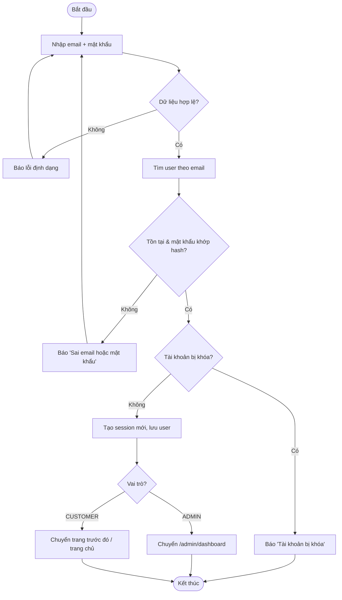

### 8.2. Tìm kiếm & lọc (AJAX)

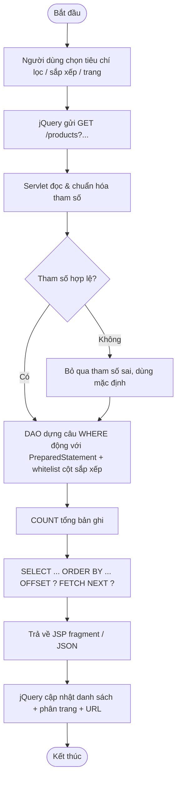

### 8.3. Đặt hàng

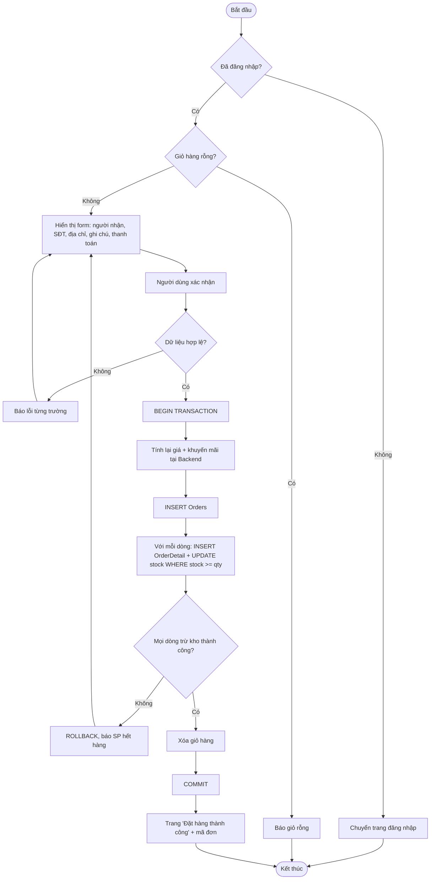

### 8.4. Đánh giá sản phẩm

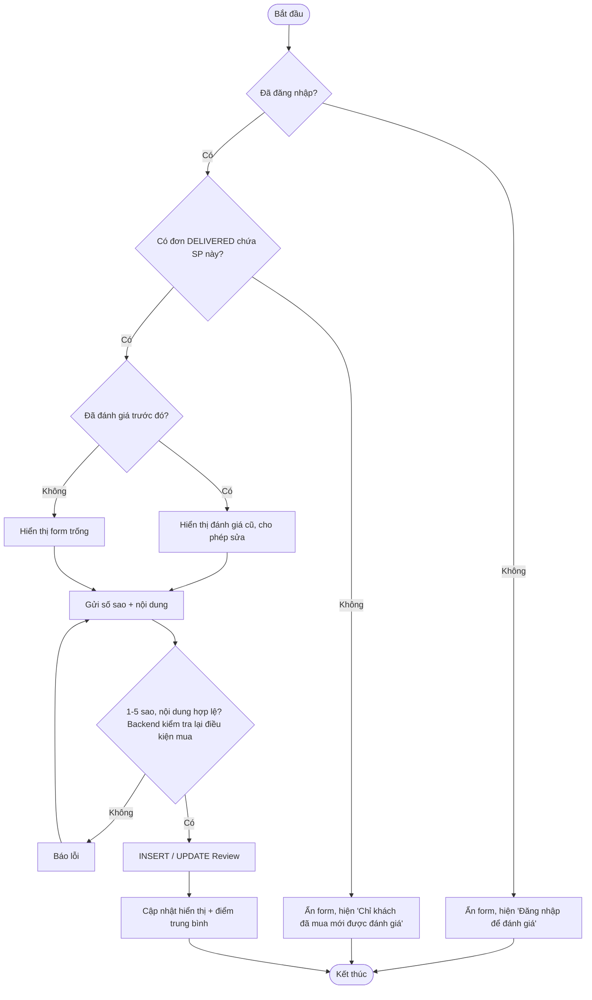

### 8.5. Admin cập nhật trạng thái đơn hàng

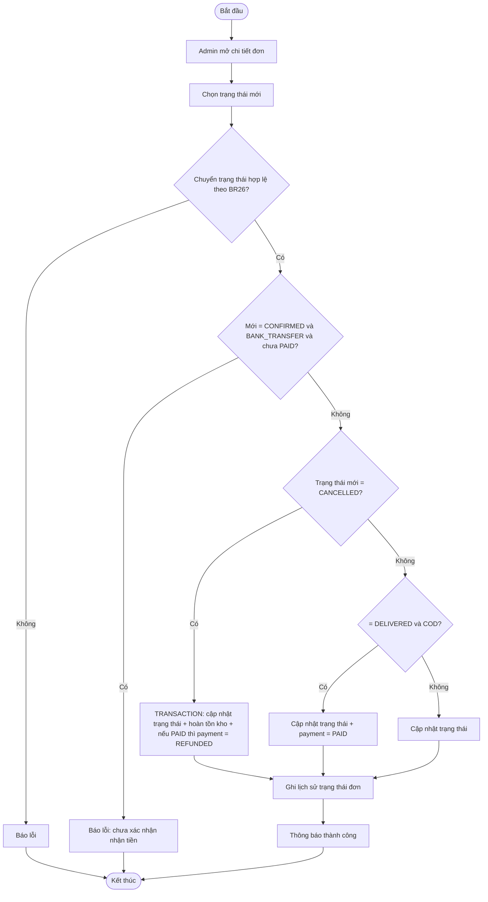

---

### 8.6. Đăng ký

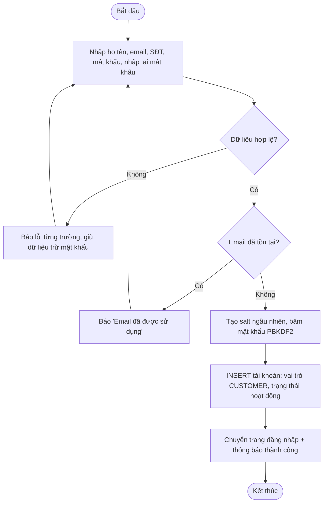

### 8.7. Thêm sản phẩm vào giỏ hàng

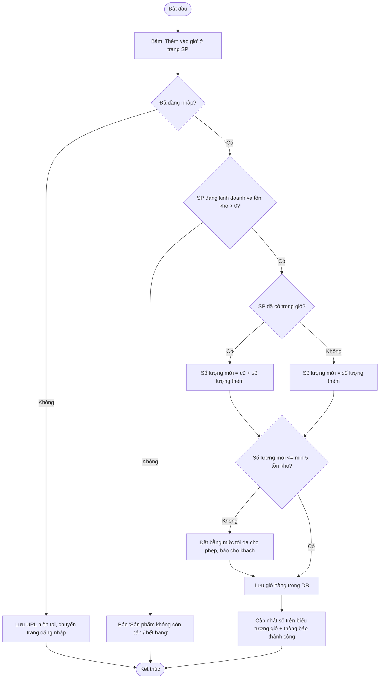

### 8.8. Khách hủy đơn hàng

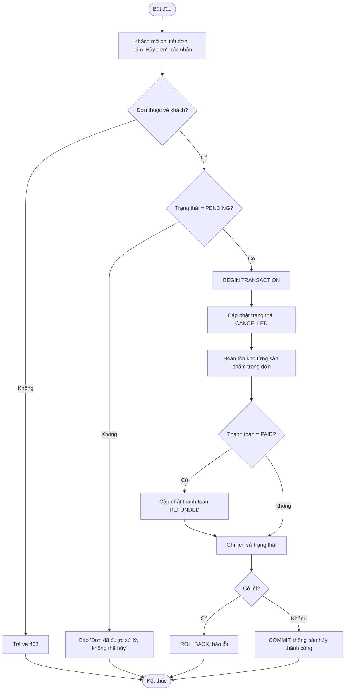

### 8.9. Admin thêm / sửa sản phẩm

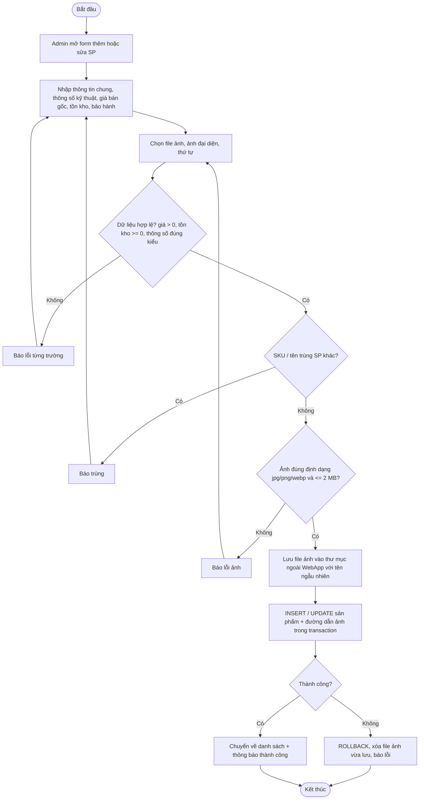

### 8.10. Admin xóa / ngừng kinh doanh sản phẩm

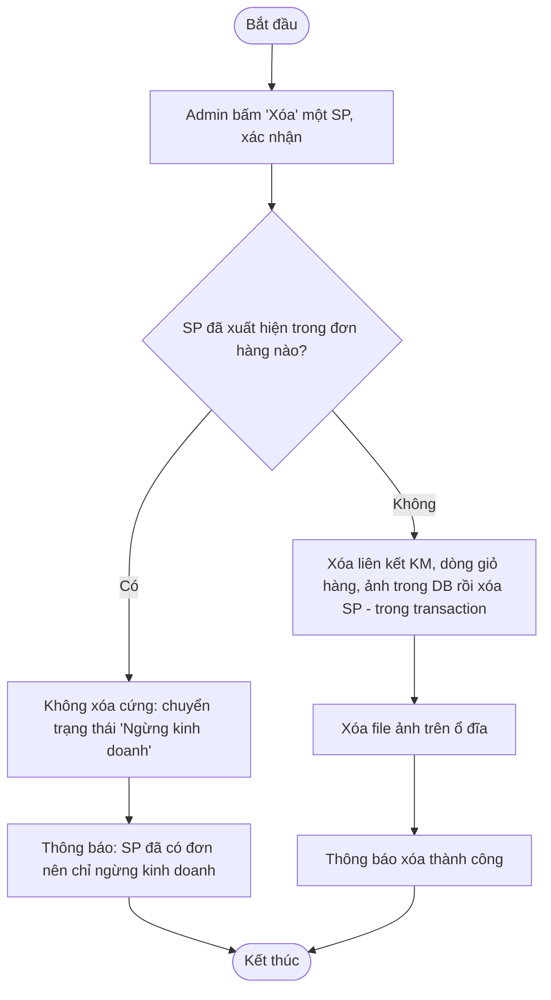

### 8.11. Admin tạo khuyến mãi và gắn sản phẩm

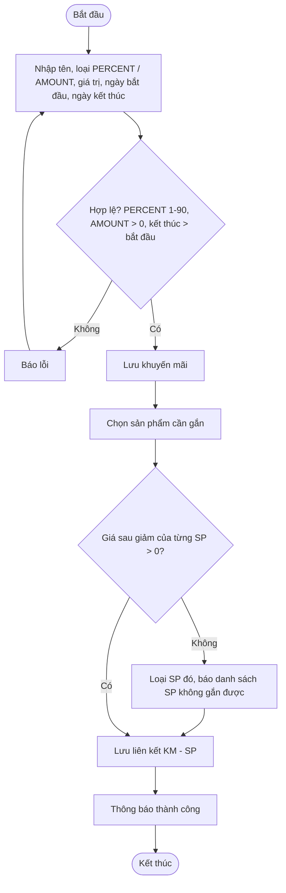

### 8.12. Tính giá hiện hành của sản phẩm (S03)

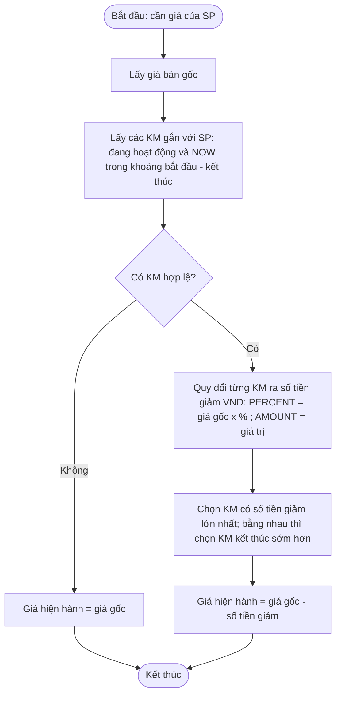

### 8.13. Admin khóa / mở tài khoản, đổi vai trò

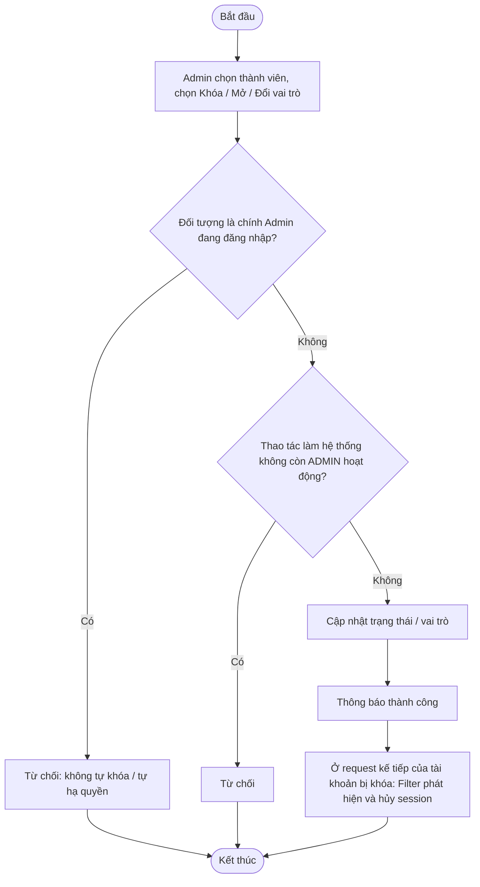

---

## 9. Danh sách câu hỏi và trạng thái xử lý

Tổng hợp: **24/24 câu đã xử lý** (21 câu ban đầu + 3 câu phát sinh Q22–Q24).

| # | Câu hỏi | Trạng thái | Kết quả | Mã QĐ |
|---|---|---|---|---|
| Q1 | Phiên bản JDK | ✅ | JDK 17.0.18 | D01 |
| Q2 | Tomcat 9 hay 10+ | ✅ | Tomcat 10.1, `jakarta.servlet` | D04 |
| Q3 | IDE, công cụ build | ✅ | IntelliJ IDEA Community + Maven 3.8.3 | D02, D03 |
| Q4 | SQL Server, kiểu xác thực | ✅ | Phiên bản có sẵn trên máy (kiểm tra ≥ 2012 bằng `SELECT @@VERSION` ở GĐ2); Windows Authentication | D05, D06 |
| Q5 | Thư viện ngoài | ✅ | JSTL (Jakarta) + Gson; PBKDF2 của JDK | D07 |
| Q6 | Biến thể cấu hình | ✅ | Mô hình A: mỗi cấu hình là 1 sản phẩm | D08 |
| Q7 | Khách vãng lai dùng giỏ / đặt hàng | ✅ | Phải đăng nhập mới thêm vào giỏ và đặt hàng | D14 |
| Q8 | Nơi lưu giỏ hàng | ✅ | Database | D09 |
| Q9 | Phương thức thanh toán | ✅ | COD + chuyển khoản ngân hàng | D10 |
| Q10 | Phí vận chuyển | ✅ | Miễn phí | D11 |
| Q11 | Nhiều KM cùng lúc | ✅ | Chỉ áp dụng mức giảm lớn nhất | D12 |
| Q12 | Coupon ở checkout | ✅ | Không sử dụng | D15 |
| Q13 | Trạng thái đơn hàng | ✅ | PENDING → CONFIRMED → SHIPPING → DELIVERED; CANCELLED (BR26) | D16 |
| Q14 | Tiêu chí tính doanh thu | ✅ | Chỉ đơn DELIVERED | D13 |
| Q15 | Sửa/xóa/ẩn đánh giá | ✅ | Khách sửa, không xóa; Admin ẩn | D18 |
| Q16 | Vai trò STAFF | ✅ | Không; chỉ CUSTOMER và ADMIN | D19 |
| Q17 | Lưu ảnh sản phẩm | ✅ | Upload vào thư mục ngoài WebApp; lưu đường dẫn trong SQL Server | D20 |
| Q18 | Giới hạn số lượng / đơn | ✅ | Tối đa 5 máy / sản phẩm / đơn | D21 |
| Q19 | Nhóm, thời hạn | ✅ | Làm 1 mình. Thời hạn nộp / mốc giữa kỳ: không cung cấp → kế hoạch không gắn ngày cụ thể | D25 |
| Q20 | Git/GitHub | ✅ | Có sử dụng | D17 |
| Q21 | Báo cáo theo mẫu Word | ✅ | Không cần file báo cáo | D24 |
| Q22 | Luồng thanh toán chuyển khoản | ✅ | Phải PAID trước khi CONFIRMED; hủy đơn đã PAID → REFUNDED | D22 |
| Q23 | Tiêu chí thống kê bán chạy / chưa bán | ✅ | Chỉ đơn DELIVERED | D26 |
| Q24 | Nguồn giá sản phẩm | ✅ | 1 giá bán gốc; giá KM tính từ bảng khuyến mãi | D23 |

## 10. Danh sách module

| Mã | Module | Phụ thuộc | Ưu tiên |
|---|---|---|---|
| M00 | Nền tảng: cấu hình DB, `DBContext`, `EncodingFilter`, layout JSP, trang lỗi, flash message | – | P0 |
| M01 | Xác thực & phân quyền (đăng ký, đăng nhập, đăng xuất, `AuthFilter`, `AdminFilter`) | M00 | P0 |
| M02 | Danh mục & Thương hiệu (Admin CRUD) | M01 | P0 |
| M03 | Sản phẩm (Admin CRUD, ảnh, thông số, tồn kho) | M02 | P0 |
| M04 | Hiển thị sản phẩm: trang chủ (phần cơ bản), chi tiết SP | M03 | P0 |
| M05 | Tìm kiếm, lọc, sắp xếp, phân trang (AJAX) | M03 | P0 |
| M06 | Giỏ hàng | M01, M03 | P0 |
| M07 | Đặt hàng (checkout, transaction, trừ kho) | M06 | P0 |
| M08 | Đơn hàng: lịch sử khách + quản lý Admin, vòng đời trạng thái, thanh toán | M07 | P0 |
| M09 | Hồ sơ cá nhân, đổi mật khẩu | M01 | P1 |
| M10 | Quản lý thành viên (Admin) | M01 | P1 |
| M11 | Đánh giá & bình luận | M08 | P1 |
| M12 | Khuyến mãi (Admin + áp giá) | M03 (ảnh hưởng M04–M07) | P1 |
| M13 | Dashboard & Thống kê | M08, M11, M12 | P1 |
| M14 | Trang chủ hoàn chỉnh (bán chạy, đánh giá cao, khuyến mãi, banner) | M11, M12, M13 | P2 |

P0 = luồng mua hàng cốt lõi; P1 = đầy đủ yêu cầu đề bài; P2 = hoàn thiện.

---

## 11. Kế hoạch triển khai

| Giai đoạn | Nội dung | Đầu ra | Điều kiện chuyển tiếp |
|---|---|---|---|
| GĐ1 | Phân tích yêu cầu | Tài liệu này (v1.0) | Đã xử lý toàn bộ Q1–Q24 + bạn xác nhận |
| GĐ2 | Thiết kế CSDL | `DATABASE_DESIGN.md`, `ERD.md`, `01_create_database.sql`, `02_seed_data.sql`, script kiểm tra toàn vẹn | Chạy SQL thành công trên máy bạn |
| GĐ3 | Thiết kế kiến trúc | `ARCHITECTURE.md`, `PROJECT_STRUCTURE.md`, khung project rỗng chạy được trên Tomcat | Trang "Hello" + kết nối DB thành công |
| GĐ4 | Backend theo module M00 → M13 (mỗi module: Entity, DAO, Servlet, JSP, validate, xử lý lỗi) | Code từng module | Mỗi module qua test case trước khi sang module kế |
| GĐ5 | Frontend hoàn thiện giao diện (làm song song theo module, hoàn thiện cuối) | JSP + CSS + JS | Responsive, đồng nhất |
| GĐ6 | Kiểm thử tổng thể (chức năng, phân quyền, SQL Injection, dữ liệu sai) | `TEST_CASES.md` có kết quả | Không còn lỗi nghiêm trọng |
| GĐ7 | Hoàn thiện, tối ưu, README, hướng dẫn cài đặt, dữ liệu demo (không làm file báo cáo – D24) | `README.md`, `CHANGELOG.md`, bộ tài liệu `docs/*.md` | Demo được toàn bộ |

Thứ tự trong GĐ4: **M00 → M01 → M02 → M03 → M04 → M05 → M06 → M07 → M08 → M09 → M10 → M11 → M12 → M13 → M14**.
Lý do: hoàn thành luồng mua hàng (P0) trước để có dữ liệu đơn thật, sau đó mới làm đánh giá, khuyến mãi, thống kê vốn phụ thuộc vào dữ liệu đơn hàng.

---

## 12. Quyết định đã xác nhận (13/11/2026)

> Lưu ý: ở phiên bản 1.0 vai trò khách hàng đổi tên từ `USER` thành `CUSTOMER` theo cách gọi trong câu trả lời Q16.

| Mã | Nội dung | Ảnh hưởng chính |
|---|---|---|
| D01 | JDK 17.0.18 | `maven-compiler-plugin` dùng `<release>17</release>` |
| D02 | IDE: IntelliJ IDEA Community | Cách chạy Tomcat trong IDE (xem C2) |
| D03 | Build: Maven 3.8.3, đóng gói WAR | Cấu trúc thư mục chuẩn Maven (`src/main/java`, `src/main/webapp`) |
| D04 | Apache Tomcat 10.1, `jakarta.servlet` | Mọi import dùng `jakarta.*`; JSTL bản Jakarta (xem C1) |
| D05 | SQL Server: phiên bản có sẵn trên máy | Kiểm tra ≥ 2012 ở GĐ2 |
| D06 | Windows Authentication | Cấu hình driver đặc biệt (xem C4); không có mật khẩu DB |
| D07 | Thư viện: JSTL + Gson; băm mật khẩu PBKDF2 của JDK | Không dùng jBCrypt |
| D08 | Mô hình sản phẩm A: mỗi cấu hình là 1 sản phẩm | Không có bảng biến thể |
| D09 | Giỏ hàng lưu trong Database | Có bảng giỏ hàng gắn `userId` |
| D10 | Thanh toán: COD + chuyển khoản ngân hàng | Admin xác nhận chuyển khoản thủ công |
| D11 | Miễn phí vận chuyển | Không có phí ship trong đơn |
| D12 | Nhiều KM cùng lúc → chỉ áp dụng mức giảm lớn nhất | So sánh theo số tiền giảm (xem C7) |
| D13 | Doanh thu chỉ tính đơn DELIVERED | Truy vấn thống kê lọc theo trạng thái |
| D14 | Khách phải đăng nhập mới thêm vào giỏ và đặt hàng | Không có giỏ Session cho khách vãng lai |
| D15 | Không dùng coupon ở checkout | Không có bảng/màn hình coupon |
| D16 | Trạng thái đơn theo BR26 | CHECK trên cột trạng thái; kiểm tra chuyển trạng thái tại Backend |
| D17 | Dùng Git/GitHub | Cần `.gitignore` loại `target/`, `.idea/`, `db.properties`, thư mục ảnh upload |
| D18 | Khách sửa (không xóa) đánh giá; Admin ẩn đánh giá | Cột trạng thái hiển thị trên bảng đánh giá |
| D19 | Chỉ 2 vai trò CUSTOMER, ADMIN | CHECK trên cột vai trò |
| D20 | Ảnh upload vào thư mục ngoài WebApp, DB lưu đường dẫn | Servlet phục vụ ảnh; đường dẫn gốc trong file cấu hình |
| D21 | Tối đa 5 máy / sản phẩm / đơn | CHECK số lượng 1–5 ở giỏ và chi tiết đơn |
| D22 | Chuyển khoản: PAID trước CONFIRMED; hủy đơn đã PAID → REFUNDED | Kiểm tra tại Backend khi cập nhật trạng thái |
| D23 | 1 giá bán gốc; giá KM tính từ bảng khuyến mãi | Bảng sản phẩm không có cột giá KM |
| D24 | Không cần file báo cáo đồ án | GĐ7 chỉ làm README + tài liệu `.md` |
| D25 | Làm 1 mình; không có mốc thời hạn cụ thể | Kế hoạch chia theo thứ tự, không gắn ngày |
| D26 | Thống kê bán chạy / chưa bán chỉ tính đơn DELIVERED | Dùng chung điều kiện với doanh thu |
| D27 | Database dùng **tên tiếng Việt không dấu** cho tên database, bảng, cột, ràng buộc, index và mã trạng thái (xác nhận 13/11/2026) | Mã trong tài liệu này (PENDING, CUSTOMER, COD…) là tên khái niệm; mã lưu trong DB xem `DATABASE_DESIGN.md` mục 1b (VD: PENDING → `CHO_XAC_NHAN`, CUSTOMER → `KHACH_HANG`, COD → `THANH_TOAN_KHI_NHAN`) |

---

## 13. Kiểm tra tính nhất quán giữa các quyết định

| Mã | Các quyết định liên quan | Kết quả | Cách xử lý |
|---|---|---|---|
| C1 | D04 Tomcat 10.1 ↔ D07 JSTL | ⚠️ Cần lưu ý | Tomcat 10.1 dùng Servlet 6.0 / JSP 3.1 (namespace `jakarta`). Phải dùng **JSTL 3.0 bản Jakarta** (`jakarta.servlet.jsp.jstl-api` + bản cài đặt `org.glassfish.web:jakarta.servlet.jsp.jstl`), taglib URI dạng `jakarta.tags.core`. JSTL 1.2 cũ (`javax`) **không chạy** trên Tomcat 10.1. Chốt phiên bản cụ thể ở GĐ3. |
| C2 | D02 IntelliJ Community ↔ D04 Tomcat | ⚠️ Cần lưu ý | Bản Community không có sẵn tích hợp Tomcat / Jakarta EE như bản Ultimate. Hai cách chạy: (a) cài plugin Smart Tomcat; (b) `mvn package` rồi đưa file WAR vào `tomcat/webapps`. [Unverified] Plugin Smart Tomcat hỗ trợ Tomcat 10.1 – sẽ kiểm tra thực tế ở GĐ3. Không ảnh hưởng kiến trúc. |
| C3 | D09 Giỏ hàng DB ↔ D14 phải đăng nhập | ✅ Đã giải quyết | Khách phải đăng nhập mới có giỏ → giỏ DB gắn `userId` là đủ, không cần giỏ Session. |
| C4 | D06 Windows Authentication ↔ JDBC / Tomcat | ⚠️ Cần lưu ý | (1) Chuỗi kết nối dùng `integratedSecurity=true`. (2) Cần file `mssql-jdbc_auth-<phiên bản>.x64.dll` **cùng phiên bản với driver mssql-jdbc**, đặt trong `java.library.path`. (3) Tomcat chạy dưới tài khoản Windows nào thì tài khoản đó phải có quyền vào database; nếu chạy Tomcat dạng Windows Service bằng tài khoản hệ thống sẽ bị từ chối đăng nhập. (4) Cần bật TCP/IP cho SQL Server và biết tên instance/cổng. Sẽ hướng dẫn chi tiết ở GĐ3. |
| C5 | D12 ↔ mục 3 / BR07 (giá) | ✅ Đã giải quyết (D23) | Chỉ còn 1 giá bán gốc trên sản phẩm; giá KM luôn tính từ bảng khuyến mãi. Đã bỏ "giá niêm yết" ở mục 3 và sửa BR07. |
| C6 | D10 ↔ D13 ↔ D16 ↔ D22 | ✅ Đã giải quyết | Doanh thu theo `DELIVERED`, độc lập trạng thái thanh toán. Chuyển khoản phải `PAID` trước `CONFIRMED`; hủy đơn đã `PAID` → `REFUNDED`. Sơ đồ 8.5 đã cập nhật. |
| C7 | D12 "mức giảm lớn nhất" ↔ BR13 (2 loại giảm) | ⚠️ Cần làm rõ | Giảm % và giảm số tiền không so sánh trực tiếp được. Đề xuất quy đổi về số tiền VND trên giá hiện tại rồi so sánh (đã ghi ở BR16). Nếu không đồng ý, vui lòng phản hồi. |
| C8 | D13 ↔ D26 | ✅ Đã giải quyết | Doanh thu và thống kê bán chạy / chưa bán dùng chung điều kiện `DELIVERED`. |
| C9 | D07 PBKDF2 ↔ BR06 tài khoản admin khởi tạo | ✅ Nhất quán, có phụ thuộc thứ tự | Script SQL seed (GĐ2) cần sẵn chuỗi hash PBKDF2 của mật khẩu admin. Hash phải tạo bằng **cùng thuật toán và tham số** với lớp băm mật khẩu Java (GĐ4–M01). Tham số (số vòng lặp, độ dài salt/hash, định dạng lưu) phải chốt trước khi viết seed. |
| C10 | D01 JDK 17 ↔ D07 Gson | ⚠️ Cần lưu ý | [Inference] Trên JDK 17, Gson có thể báo lỗi khi chuyển trực tiếp kiểu `java.time.LocalDateTime` sang JSON (do hạn chế truy cập module). Xử lý: dùng `TypeAdapter` riêng hoặc trả DTO với ngày dạng chuỗi. Sẽ kiểm chứng ở module tìm kiếm AJAX. |
| C11 | D01 JDK 17 ↔ D03 Maven 3.8.3 ↔ D04 Tomcat 10.1 | ✅ Nhất quán | Tomcat 10.1 yêu cầu Java ≥ 11; JDK 17 đáp ứng. Maven 3.8.3 chạy được với JDK 17. |
| C12 | D08 Mô hình A ↔ tìm kiếm/lọc, giỏ hàng, đánh giá | ✅ Nhất quán | Mỗi sản phẩm có thông số riêng → lọc trực tiếp trên bảng sản phẩm. Giỏ/đơn/đánh giá tham chiếu `productId`. |
| C13 | D11 Miễn phí vận chuyển ↔ BR25 tổng tiền | ✅ Nhất quán | Tổng đơn = tổng tiền hàng. |
| C14 | D06 Windows Auth ↔ NF02 không ghi cứng thông tin nhạy cảm | ✅ Nhất quán | Không có mật khẩu DB; `db.properties` chỉ chứa server, cổng/instance, tên database. |
| C15 | D20 ảnh ngoài WebApp ↔ D17 Git | ⚠️ Cần lưu ý | Thư mục ảnh upload không nằm trong mã nguồn → không lên Git. Ảnh dữ liệu demo cần có cách cài riêng (VD: thư mục `sample-images/` trong repo, copy sang thư mục upload khi cài đặt). Chốt ở GĐ2/GĐ3. |
| C16 | D21 tối đa 5 máy ↔ BR19 thêm SP đã có trong giỏ | ✅ Nhất quán | Khi cộng dồn số lượng, nếu vượt 5 → giữ tối đa 5 và thông báo. |
| C17 | D22 ↔ BR27 khách hủy đơn | ✅ Nhất quán | Đơn chuyển khoản có thể đã `PAID` khi còn `PENDING`; nếu khách hủy → `REFUNDED`. |
| C18 | D16 ↔ D18 ↔ BR30 điều kiện đánh giá | ✅ Nhất quán | Chỉ đơn `DELIVERED` mới mở quyền đánh giá; đánh giá bị ẩn không tính vào điểm trung bình. |

---

## 14. Các đề xuất chưa có câu hỏi riêng

Các mục dưới đây vẫn mang nhãn **[Đề xuất]** trong tài liệu. Chúng không nằm trong danh sách Q1–Q24. **Khi chủ dự án xác nhận tài liệu v1.0, các đề xuất này được coi là đã chấp nhận**, trừ mục nào được yêu cầu sửa.

| Mã | Đề xuất | Vị trí |
|---|---|---|
| P01 | Ngoài phạm vi: email/SMS, quên mật khẩu qua email, serial máy, app di động, đa ngôn ngữ | Mục 1.2 |
| P02 | Bổ sung chức năng Admin: quản lý thương hiệu (A03), quản lý đánh giá (A09), quản lý banner từ DB (A10) | Mục 4.2 |
| P03 | Admin không tự khóa / tự hạ quyền; luôn còn ≥ 1 ADMIN | BR05 |
| P04 | Tài khoản admin đầu tiên tạo bằng script SQL seed | BR06 |
| P05 | Sản phẩm đã có đơn chỉ ngừng kinh doanh, không xóa cứng; danh mục/thương hiệu còn SP không được xóa | BR09, BR11 |
| P06 | Loại KM `PERCENT` (1–90 %) và `AMOUNT`; so sánh "giảm lớn nhất" theo số tiền VND; bằng nhau lấy KM kết thúc sớm hơn | BR13, BR14, BR16 |
| P07 | Trạng thái thanh toán `UNPAID` / `PAID` / `REFUNDED`; COD chuyển `PAID` khi `DELIVERED` | BR29 |
| P08 | Khách hủy được ở `PENDING`; Admin hủy được ở `PENDING`, `CONFIRMED`; không chuyển ngược trạng thái | BR27 |
| P09 | Mỗi khách đánh giá mỗi sản phẩm 1 lần; nội dung 10–1000 ký tự | BR31, BR32 |
| P10 | Doanh thu gom theo ngày đơn chuyển sang `DELIVERED` (cần lưu thời điểm giao) | BR34 |
| P11 | Ngưỡng tồn kho thấp mặc định = 5; "Đánh giá cao" = AVG ≥ 4 | BR35, BR37 |
| P12 | Chống CSRF bằng token cho form POST; lưu lịch sử thay đổi trạng thái đơn | NF04, sơ đồ 8.5 |
| P13 | Phân trang 12 SP/trang (khách), 10 dòng/trang (Admin); số lượng dữ liệu demo theo NF12 | NF06, NF12 |

---

## 15. Ma trận truy vết yêu cầu đề bài → chức năng → Use Case

| Yêu cầu đề bài | Chức năng | UC | Activity |
|---|---|---|---|
| 4.1 Trang chủ | U01 | UC01 | 8.12 |
| 4.2 Tìm kiếm & lọc | U02 | UC02 | 8.2 |
| 4.3 Chi tiết sản phẩm | U03 | UC03 | 8.12 |
| 4.4 Tài khoản (đăng ký, đăng nhập, đăng xuất, hồ sơ, đổi mật khẩu, lịch sử đơn) | U04–U08, U11 | UC04–UC08, UC11 | 8.1, 8.6 |
| 4.5 Giỏ hàng | U09 | UC09 | 8.7 |
| 4.6 Đặt hàng, theo dõi trạng thái | U10, U11, U12 | UC10–UC12 | 8.3, 8.8 |
| 4.7 Bình luận & đánh giá | U13 | UC13 | 8.4 |
| 5.1 Dashboard | A01 | UC14 | – |
| 5.2 Quản lý danh mục | A02 (+ A03 thương hiệu) | UC15, UC16 | – (CRUD chuẩn) |
| 5.3 Quản lý sản phẩm | A04 | UC17 | 8.9, 8.10 |
| 5.4 Quản lý đơn hàng | A05, A05b, A05c | UC18–UC20 | 8.5 |
| 5.5 Quản lý thành viên | A06 | UC21 | 8.13 |
| 5.6 Quản lý khuyến mãi | A07 | UC22 | 8.11, 8.12 |
| 5.7 Thống kê | A08 | UC25 | – |
| (bổ sung) Quản lý đánh giá, banner | A09, A10 | UC23, UC24 | – (CRUD chuẩn) |

Kết quả: mọi yêu cầu chức năng trong đề bài đều có chức năng, Use Case tương ứng. Các chức năng có luồng phức tạp (giao dịch, phân quyền, tính giá) đều có Activity Diagram.

---

## 16. Kiểm tra hoàn thành Giai đoạn 1

| Hạng mục bắt buộc (đề bài – Giai đoạn 1) | Vị trí | Trạng thái |
|---|---|---|
| Phân tích đề bài | Mục 1, 3 | ✅ |
| Xác định mục tiêu | Mục 1.1, 1.2 | ✅ |
| Xác định đối tượng sử dụng | Mục 2 | ✅ |
| Liệt kê chức năng User | Mục 4.1 (13 chức năng) | ✅ |
| Liệt kê chức năng Admin | Mục 4.2 (12 chức năng) | ✅ |
| Xác định quy tắc nghiệp vụ | Mục 5 (BR01–BR37) | ✅ |
| Xác định yêu cầu phi chức năng | Mục 6 (NF01–NF12) | ✅ |
| Use Case Diagram | Mục 7.2–7.4 (3 sơ đồ) + đặc tả mục 7.5 | ✅ |
| Activity Diagram cho chức năng chính | Mục 8 (13 sơ đồ) | ✅ |
| Xử lý toàn bộ câu hỏi còn thiếu | Mục 9 (24/24) | ✅ |
| Kiểm tra tính nhất quán | Mục 13 (C1–C18) | ✅ |
| **Chủ dự án xác nhận** | Yêu cầu chuyển sang GĐ2 ngày 13/11/2026 (chấp nhận cả P01–P13) | ✅ |
